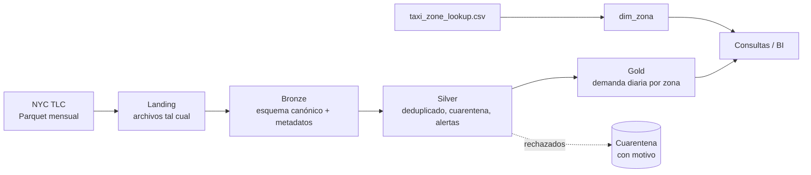
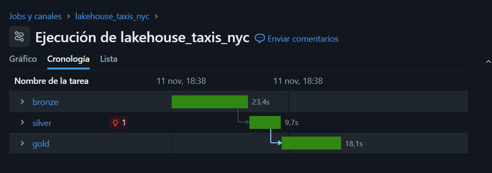
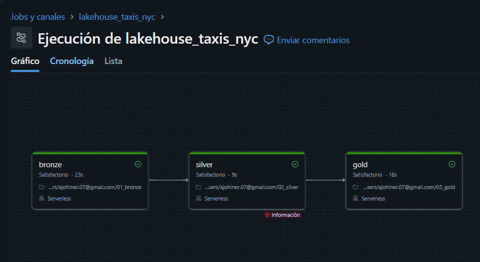
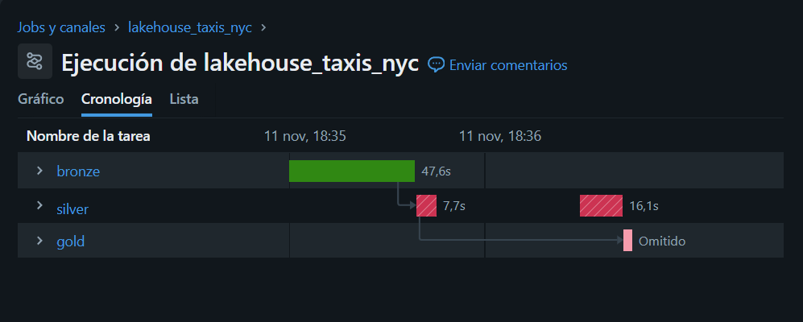
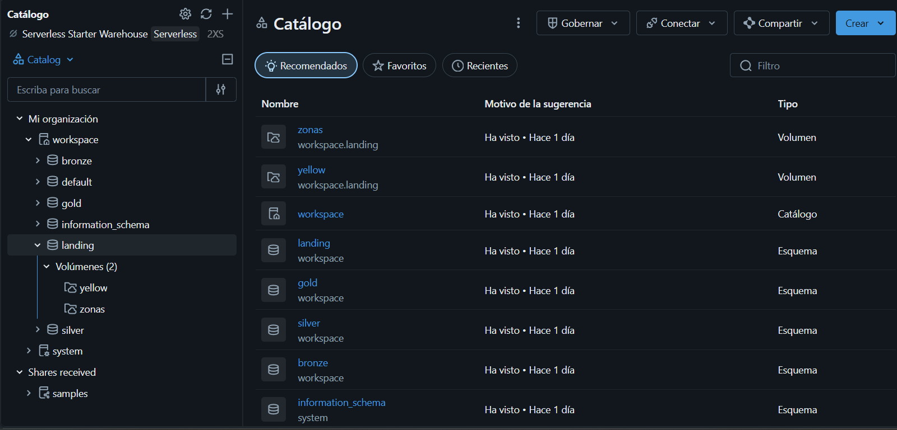
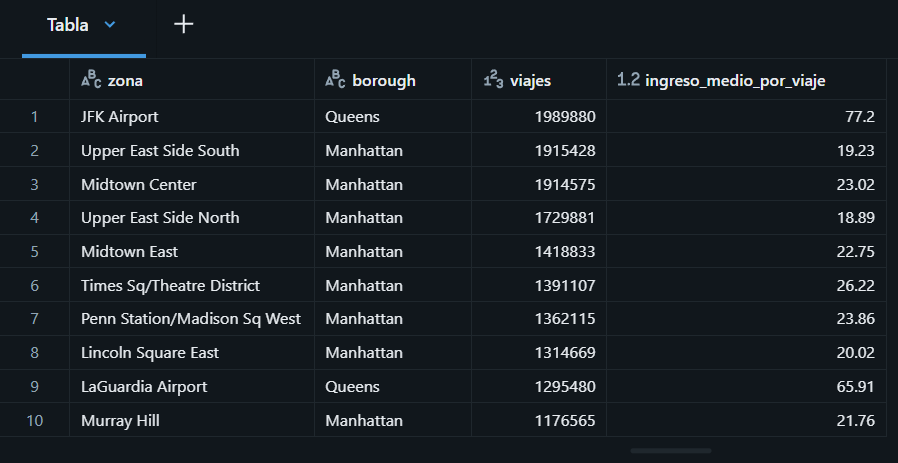

# lakehouse-taxis-nyc

<h1 align="center">Lakehouse de taxis de Nueva York</h1>

<p align="center">
  Lakehouse con arquitectura medallion de punta a punta: ingesta, capas bronze, silver y gold
  con Spark y Delta Lake, calidad de datos con cuarentena, orquestación y réplica en Databricks.
</p>

<p align="center">
  
  
  
  
  
</p>

> Proyecto de portafolio de ingeniería de datos. Todas las decisiones de diseño están documentadas en este README y en [`docs/`](docs/).

---

## Qué demuestra este proyecto

- Diseño de un lakehouse con capas medallion y **tablas Delta** (transacciones ACID, `MERGE`, `replaceWhere`, `OPTIMIZE`, `ZORDER`).
- **Calidad de datos explícita**: criterio "se rechaza lo imposible, se marca lo sospechoso", tabla de cuarentena con el motivo y conciliación obligatoria en cada capa.
- **Cargas idempotentes** por mes: se puede volver a ejecutar cualquier paso sin duplicar ni perder datos.
- **Medición de rendimiento** con un laboratorio reproducible (archivos pequeños, poda de particiones, Z-order, AQE), reportando mediana y rango por el ruido de una laptop de 8 GB.
- **Orquestación** en dos entornos: un script local con logs y códigos de salida, y un Job de Databricks con dependencias entre tareas.
- **Validación entre entornos**: el pipeline local y el de Databricks producen exactamente los mismos totales.

## Arquitectura



| Capa | Contenido | Escritura |
| --- | --- | --- |
| **Bronze** | Los datos tal como llegan, con esquema canónico (nombres en minúscula, tipos forzados) y metadatos `_archivo`, `_mes_origen`, `_cargado_en`. Las columnas nuevas que aparezcan se conservan. | `replaceWhere` por mes |
| **Silver** | Duplicados exactos eliminados, filas imposibles a cuarentena, columnas derivadas (`viaje_id`, `fecha_recogida`, `hora_recogida`, `duracion_min`) y columnas de alerta para lo sospechoso. | `replaceWhere` por mes |
| **Gold** | `fct_demanda_diaria_zona` (un registro por día y zona de origen) y `dim_zona`. | `MERGE` por mes |

## Stack

| Local | Databricks Free Edition |
| --- | --- |
| Spark 4.1.1 (modo local) + delta-spark 4.1.0 | Cómputo serverless |
| Python 3.12, Java 17 | Notebooks en Python |
| Docker Compose | Unity Catalog (catálogo `workspace`) |
| Orquestador propio (`run_pipeline.py`) | Databricks Jobs |

## Datos

- **Fuente:** [NYC TLC Trip Record Data](https://www.nyc.gov/site/tlc/about/tlc-trip-record-data.page), viajes de taxis amarillos en Parquet, más `taxi_zone_lookup.csv`.
- **Local:** 36 meses (2023-01 a 2025-12), 128,202,548 filas procesadas. Los datos no se versionan en el repo: se descargan con `src/descargar.py`.
- **Databricks Free:** solo 2024 (12 meses, 41,167,491 viajes), por los límites de la edición gratuita.

El esquema cambia entre meses (por ejemplo `cbd_congestion_fee` aparece desde 2025-01 y `Airport_fee` cambia de capitalización). Bronze lo absorbe sin fallar: las columnas ausentes entran como nulas y las nuevas se conservan.

## Decisiones de diseño

**1. Rechazar lo imposible, marcar lo sospechoso.** Es el mismo criterio que `error` frente a `warn` en dbt. Descartar en silencio el 13 % de viajes sin número de pasajeros eliminaría 17 millones de filas que un analista podría necesitar.

| Se rechaza (cuarentena) | Se marca con alerta y se conserva |
| --- | --- |
| Fechas nulas | Pasajeros nulos, 0 o más de 6 |
| Recogida fuera del mes del archivo | Duración cero |
| Bajada antes de la subida | Distancia cero o mayor a 100 millas |
| Duración mayor a 24 horas | Importe total menor o igual a cero |

Los hallazgos que llevaron a estas reglas están en [`docs/exploracion_bronze.md`](docs/exploracion_bronze.md).

**2. Conciliación en cada capa.** Silver verifica por mes que `bronce = duplicados + rechazados + válidos`. Gold verifica que la suma de viajes iguale las filas de silver. Si algo no cuadra, el paso falla.

**3. Medidas aditivas en gold.** La tabla guarda sumas y conteos, nunca promedios. Los promedios se calculan al consultar (`SUM(ingresos_total) / SUM(viajes_limpios)`), porque un promedio de promedios es incorrecto. Las medidas de dinero, distancia y duración suman **solo viajes limpios** (sin alertas); `viajes` cuenta todos y `viajes_con_alertas` indica cuántos quedaron fuera.

**4. Silver no cruza con zonas.** Silver es el hecho limpio; el cruce con `taxi_zone_lookup` ocurre en gold como dimensión.

**5. Idempotencia por mes.** Bronze y silver reemplazan solo la partición del mes (`replaceWhere`); gold usa `MERGE` con `WHEN NOT MATCHED BY SOURCE ... DELETE` acotado al mes. Volver a ejecutar cualquier mes no duplica filas.

**6. Horas locales sin desplazar.** La sesión de Spark usa zona horaria UTC y la inferencia de `TIMESTAMP_NTZ` está desactivada, para que las horas de Nueva York queden tal cual vienen en el archivo.

## Estructura del repositorio

```
lakehouse-taxis-nyc/
├── src/
│   ├── spark_session.py            # sesión de Spark con Delta
│   ├── verificar_entorno.py        # prueba de humo del entorno
│   ├── descargar.py                # descarga idempotente desde TLC
│   ├── bronze_taxis.py
│   ├── silver_taxis.py
│   ├── gold_taxis.py
│   ├── laboratorio_rendimiento.py
│   └── run_pipeline.py             # orquestador local
├── databricks/                     # notebooks exportados (00_setup a 03_gold)
├── docs/
│   ├── exploracion_bronze.md
│   ├── rendimiento.md
│   └── img/                        # capturas de Databricks
├── Dockerfile
├── docker-compose.yml
└── requirements.txt
```

## Cómo ejecutarlo

### Local (Docker)

Requisitos: Docker Desktop con al menos 3.5 GiB de memoria.

```bash
docker compose up -d --build
docker compose exec spark python src/verificar_entorno.py

# Pipeline completo: descarga -> bronze -> silver -> gold
docker compose exec spark python src/run_pipeline.py

# Un rango de meses
docker compose exec spark python src/run_pipeline.py --desde 2024-01 --hasta 2024-03
```

`run_pipeline.py` ejecuta cada paso en un proceso separado (importante con poca memoria), guarda el log en `logs/` y termina con código de salida 1 si algún paso falla. Opciones: `--saltar-descarga`, `--forzar`, `--probar-fallo`.

Cada paso también se puede ejecutar por separado, con `--solo AAAA-MM` y `--forzar`:

```bash
docker compose exec spark python src/bronze_taxis.py
docker compose exec spark python src/silver_taxis.py --solo 2024-01
docker compose exec spark python src/gold_taxis.py
```

### Databricks Free Edition

1. Crear los esquemas `landing`, `bronze`, `silver` y `gold` en el catálogo `workspace`, y los volúmenes `landing.yellow` y `landing.zonas` (ver [`databricks/00_setup.py`](databricks/00_setup.py)).
2. Subir a los volúmenes los 12 Parquet de 2024 y `taxi_zone_lookup.csv`.
3. Importar los notebooks `01_bronze`, `02_silver` y `03_gold`.
4. Crear un Job `lakehouse_taxis_nyc` con tres tareas encadenadas (bronze → silver → gold) en cómputo serverless.

### Capturas

**Job con tres tareas encadenadas (bronze → silver → gold):**



**Cronología de una ejecución:**



**Prueba de fallo: `silver` falla y `gold` no se ejecuta:**



**Arquitectura medallion en Unity Catalog:**



**Resultado: Top 10 de zonas de origen:**



Las diferencias respecto a la versión local: tablas gestionadas de Unity Catalog en vez de rutas, `_metadata.file_name` en lugar de `input_file_name()`, y sin `persist()` (el cómputo serverless no lo admite).

**Evidencia de ejecución:** las capturas anteriores corresponden a una corrida real del Job (tres tareas en verde), y la tabla de validación de la sección *Resultados* compara sus totales con los del pipeline local. El Job vive en el workspace de Databricks; en el repo se versionan los notebooks.

## Resultados

**Top 10 de zonas de origen** (local, 2023-2025):

| Zona | Distrito | Viajes |
| --- | --- | ---: |
| JFK Airport | Queens | 6,044,450 |
| Upper East Side South | Manhattan | 5,832,742 |
| Midtown Center | Manhattan | 5,770,298 |
| Upper East Side North | Manhattan | 5,201,233 |
| Midtown East | Manhattan | 4,280,701 |
| Penn Station/Madison Sq West | Manhattan | 4,210,332 |
| Times Sq/Theatre District | Manhattan | 4,178,070 |
| Lincoln Square East | Manhattan | 3,958,227 |
| LaGuardia Airport | Queens | 3,892,014 |
| Murray Hill | Manhattan | 3,602,554 |

**Validación entre entornos (2024):** el pipeline local y el de Databricks coinciden exactamente.

| | Viajes | Ingresos (viajes limpios) |
| --- | ---: | ---: |
| Local | 41,167,491 | 1,034,001,665.59 |
| Databricks | 41,167,491 | 1,034,001,665.59 |

La validación detectó un error real durante el desarrollo: la primera versión del gold de Databricks sumaba todos los viajes en las medidas de dinero, y no solo los limpios. La conciliación lo hizo visible y se corrigió.

**Tiempos:** la ejecución completa local sin novedades (todo omitido) toma unos 3.5 minutos; el Job de Databricks, 1 min 19 s.

## Laboratorio de rendimiento

Cuatro experimentos sobre la tabla silver, medidos con la mediana de varias corridas y su rango (detalle y método en [`docs/rendimiento.md`](docs/rendimiento.md)):

| Experimento | Antes | Después |
| --- | --- | --- |
| **A.** Compactación de archivos pequeños (`OPTIMIZE`) | 6.8 s, 400 archivos | 0.8 s, 1 archivo |
| **B.** Poda de particiones | 12.2 s (escaneo completo) | 4.9 s (filtro por partición) |
| **C.** `ZORDER` | 2.1 s | 1.3 s (resultado dentro del ruido) |
| **D.** Particiones de shuffle / AQE | 3.0 s (200 particiones, AQE off) | 1.8-1.9 s (8 particiones, o AQE on) |

Lectura honesta de los resultados: las mediciones se hicieron en una laptop de 8 GB y tienen ruido. Las mejoras de A, B y D son claras; la de C no es concluyente. Por eso se reportan mediana y rango, no una sola corrida.

## Límites conocidos

- **Memoria:** con Docker limitado a 3.5 GiB, cada paso y cada experimento corre en su propio proceso. Una sola sesión larga de Spark agotaba la memoria del contenedor.
- **Airflow:** no se usó en este proyecto porque Spark y Airflow no caben juntos en esa memoria. La orquestación local es un script propio; la orquestada, el Job de Databricks.
- **Databricks Free:** solo serverless, internet restringido y 2024 como único año cargado.
- **Mediciones de rendimiento:** con ruido; la explicación de por qué mejora el experimento B (omisión de datos de Delta) no está verificada con las métricas internas.

## Siguientes pasos

- [ ] Cargar la capa gold en un warehouse (Snowflake o BigQuery) con modelos dbt.
- [ ] Mostrar resúmenes finales solo cuando hubo trabajo nuevo, para acortar la corrida sin novedades.
- [ ] Parametrizar los notebooks de Databricks (widgets) para ejecutar un mes concreto desde el Job.

## Fuente de datos y licencia

Datos públicos de la NYC Taxi & Limousine Commission. Este repositorio contiene solo el código; los datos no se incluyen (se descargan con `src/descargar.py`).
